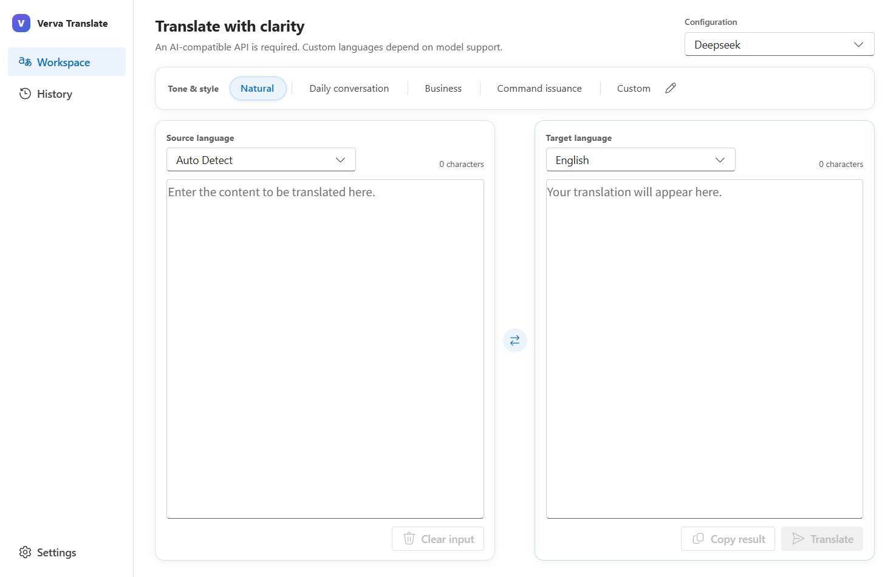
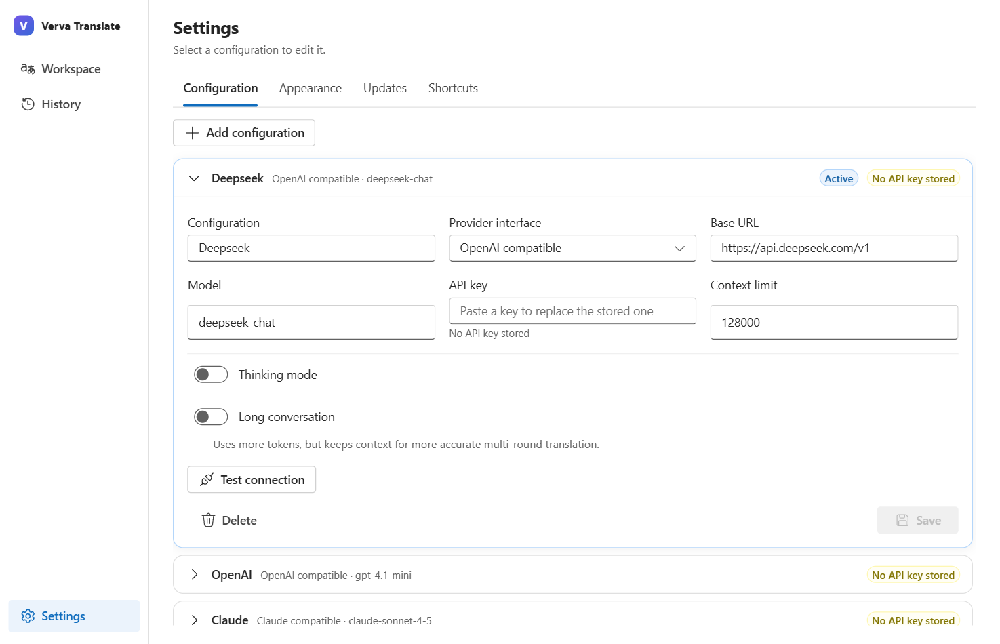

# Verva Translate

**English** · [简体中文](README.zh-CN.md)

> Carry the meaning. Keep the voice.

Verva Translate is a Windows-first, bring-your-own-AI translator. It connects directly to an OpenAI-compatible or Claude-compatible endpoint and lets you control the model, cost, target language, and tone instead of paying for another bundled AI subscription.

I started Verva because I was extremely dissatisfied with machine translation. Too many tools return wording that is technically correct but stiff, context-blind, or unlike anything a person would actually say. Better AI translators often add an expensive monthly fee, while still preventing users from choosing the API and model themselves. Verva exists to return that control to the user.

## Preview

The workspace: tone and style above, each language selector on the pane it applies to.



Settings: configurations are a list; selecting one opens the full editor with a connectivity test.



## Highlights

- OpenAI-compatible and Claude-compatible streaming APIs. Translation uses the endpoint and model you choose.
- Multiple named configurations with fast switching, encrypted API keys, an adjustable thinking level, and optional long conversations.
- A Local Models page downloads explicit quantized translation models or a custom Ollama model name, shows progress and approximate VRAM/RAM needs for recommendations, supports an optional HTTP proxy entered as IP:port and download cancellation, and runs an installed model as a translation configuration. Qwen3.5 4B is the general recommendation and TranslateGemma 4B is the translation-focused recommendation.
- An Image to Text page uses PP-OCRv6 Small on the local CPU for Chinese and English. The first use downloads compact OCR model files. Long images fill the preview width, scroll independently, and can be zoomed. Extracted text is editable; translation is optional.
- Normal, Natural, Conversation, Business, Command, Professional, and user-authored styles.
- The source language starts at Auto Detect on each app launch and keeps your selection while you move between pages. Swap exchanges both languages and the source/result text for reverse translation.
- Major target languages plus a final Custom option for any language supported by the chosen model.
- Editable streamed results, Stop and Copy on the result pane, Clear on the source pane, and configurable shortcuts.
- Settings and History are in-app pages, not extra windows; English or Simplified Chinese can be selected inside the app.
- A connectivity test for each configuration, so a Base URL, model, and key can be checked before translating.
- Closing the window can minimize to the notification area, quit, or ask each time.
- Stronghold-encrypted local history limited to 100 entries, single-instance behavior, and stable/beta signed updates.
- A conventional bilingual NSIS installer with destination selection and progress, plus a versioned portable executable.

## Download

Download a release from [GitHub Releases](https://github.com/Trilives/verva-translator/releases):

- `Verva-Translate-<version>-windows-x64-setup.exe` — recommended installer. It offers an installation-language selector, optional destination selection, progress UI, shortcuts, and uninstall support.
- `Verva-Translate-<version>-windows-x64-portable.exe` — portable build. It reports available updates but never replaces itself automatically.

Translation requires an AI-compatible endpoint; Ollama provides one locally. Custom language support, thinking mode, quality, and any provider charges depend on the chosen model.

## Configure translation

For local translation, install and start [Ollama for Windows](https://ollama.com/download/windows); the download link in the app opens your default browser. If Ollama is installed but stopped, the app prompts you to start it. In **Local Models**, download a recommended Q4_K_M 4B model, choose **Run model**, then **Use in translation**. The optional download proxy field accepts a local HTTP proxy as `127.0.0.1:7897` when a network returns a `198.18.x.x` fake IP; leave it blank for Ollama's normal connection. See [model sizes and proxy behavior](docs/local-models-and-ocr.md) for details. OCR does not require Ollama.

1. Open **Settings** from the left rail.
2. Add a configuration, or select one to expand it.
3. Choose **OpenAI compatible** or **Claude compatible**.
4. Enter its Base URL and select or type a model name. Public endpoints require HTTPS; localhost and private LAN addresses may use HTTP and do not require an API key.
5. Optionally set a thinking level or enable Long conversation.
6. Changes save automatically. Use **Test connection** to confirm the endpoint answers.
7. Return to the workspace and pick the configuration from the header.

Long conversation keeps source/result pairs in memory and repeats the translation requirements on every request. It improves consistency across related rounds but uses more tokens. Verva shows the session start time, provides a refresh action, and warns at 50% of the configured context limit.

## Build from source

Requirements on Windows:

- Node.js 20 or newer
- Rust stable
- Microsoft C++ Build Tools with the Desktop development with C++ workload
- Microsoft Edge WebView2 Runtime

```powershell
npm install
npm run tauri dev
```

Run verification:

```powershell
npm test
npm run build
cargo test --manifest-path src-tauri/Cargo.toml
npm run tauri -- build
```

## Security and local data

- Non-secret preferences use the official Tauri Store plugin.
- API keys and the bounded history use the official Stronghold engine. Its random vault master key is protected for the current Windows account with DPAPI.
- Provider keys are read only by Rust, never placed in ordinary settings or logs.
- App data resolves through Tauri's Windows app-data directory and never depends on this repository path or a developer username.
- Public model endpoints require HTTPS; loopback and private LAN endpoints may use HTTP.
- The official Tauri Updater verifies signed update artifacts. Stable and beta use independent rolling manifests.

Source text is sent to the endpoint you configure. Review that provider's data policy before translating sensitive material.

## Project structure

```text
src/                         React + TypeScript + Fluent UI React v9
  components/                Focused reusable UI pieces
  domain/                    Provider-neutral types and catalogs
  hooks/                     Application interaction state
  i18n/                      English and Simplified Chinese messages
  pages/                     Workspace, Local Models, Image to Text, History, Settings
  services/                  Typed Tauri/plugin adapters
src-tauri/                   Tauri 2 Rust desktop core
  capabilities/              Per-window least-privilege policy
  src/providers/             OpenAI/Claude streaming adapters
  src/security.rs            DPAPI-protected Stronghold bootstrap
  src/tray.rs                Notification-area icon and menu
docs/                        Architecture and modularization notes
.github/workflows/           Stable/beta Windows release pipeline
```

Read [architecture.md](docs/architecture.md) and [modularization.md](docs/modularization.md) before making structural changes.

## Release signing

GitHub Actions expects `TAURI_SIGNING_PRIVATE_KEY` and `TAURI_SIGNING_PRIVATE_KEY_PASSWORD` repository secrets. The matching public key is committed in `src-tauri/tauri.conf.json`. The workflow validates stable/beta SemVer, runs tests, builds the portable executable and NSIS installer, creates SHA-256 files, publishes signed updater artifacts, and refreshes the chosen channel manifest.
